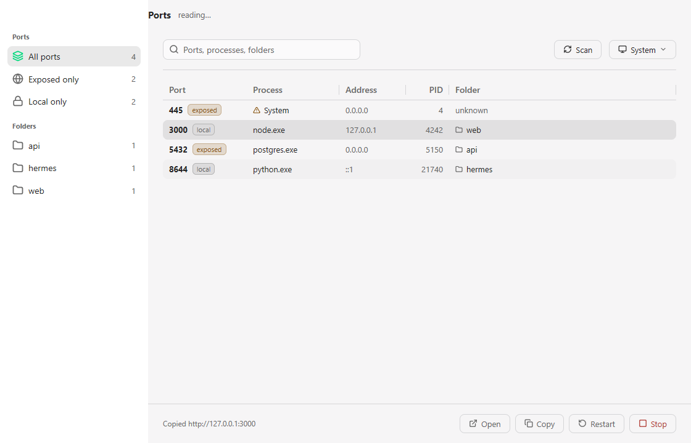
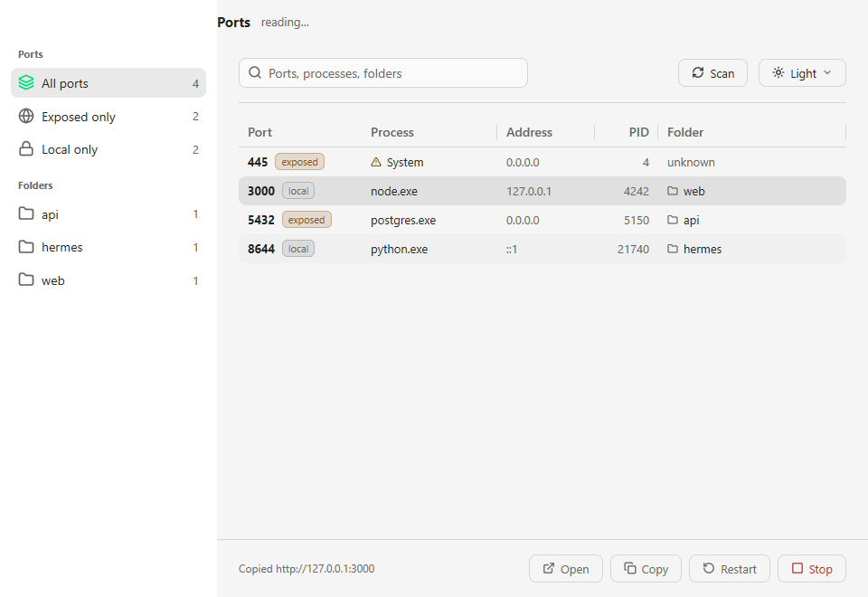
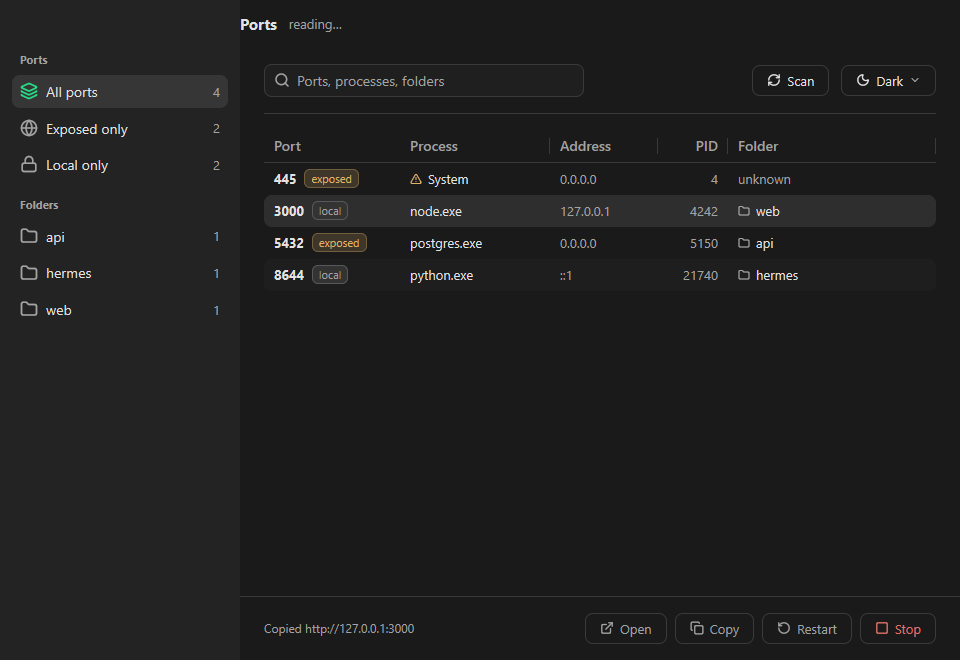

<p align="center">
  
</p>

<h1 align="center">Ports</h1>

<p align="center">
  See what is listening on your machine, and which project it belongs to.
</p>

---

A native Windows app that lists every listening TCP port with the process that owns it, the PID, and **the folder it was started in**. That last one is the point: `netstat` tells you a port is taken, this tells you *which project* took it.

It is built with [MyGo](https://github.com/egoist/mygo) and [Onevra](https://github.com/oneo-me/onevra) - pure Go, no cgo, no webview, drawn on the GPU. One 14 MB binary that opens instantly.

```
  Port           Process       Address      PID     Folder
  445  exposed   System        0.0.0.0      4       unknown
  3000 local     node.exe      127.0.0.1    4242    web
  5432 exposed   postgres.exe  0.0.0.0      5150    api
  8644 local     python.exe    ::1          21740   hermes
```

## What it does

- **Lists every listening TCP port**, IPv4 and IPv6, with its process and PID.
- **Shows the working directory** of each process, so two servers of the same program are told apart by the project they serve.
- **Marks each port exposed or local**, so "can another machine reach this?" is answered on the row rather than inferred from the address.
- **A sidebar** that narrows the list three ways - every port, only the exposed ones, only the local ones - and lists one entry per project folder, with its count.
- **Search** across port, process, address and folder.
- **Sort** by any column, and resize or reorder the columns.
- **Open** a port in the browser, or **copy** its address.
- **Stop** or **restart** a process, after a confirmation that names it. A restart reuses the original command line and working directory.
- **Rescans every two seconds**, off the UI thread, so the list stays current without a refresh key.
- **Keyboard**: `F` for the search, `R` to rescan, `Ctrl+K` for a command palette over the ports and the actions.
- **Closes to the tray**, and keeps scanning there.
- **Light, dark, or the desktop's own appearance**, from a menu on the button.

## Screenshots

| Light | Dark |
|---|---|
|  |  |

## Install

Download the installer from [Releases](../../releases/latest) and run it. It installs per user to `%LOCALAPPDATA%\Programs\ports` with no administrator prompt, and adds a Start Menu entry. Uninstall from Settings, Apps.

More at [yaffalhakim1.github.io/ports](https://yaffalhakim1.github.io/ports/).

## Build

Needs [Go](https://go.dev/dl/) 1.27 or later. No other toolchain, no Node, no webview runtime.

```sh
go tool mygo build      # ports.exe and the installer, in build/windows-amd64
go tool mygo dev        # run with live reload
go tool mygo vet .      # the lint the project is kept to
go test ./...           # the tests
go test -run TestRender ./internal/app/   # rewrite testdata/*.png
```

The screenshots in this file are test output: `TestRender` writes `testdata/`, and
`docs/` and `landing/assets/` hold copies of it.

## Landing page

`landing/` is the site GitHub Pages publishes. Its three figures are built from
the app's own model by the kit in `landing/anatomy/`:

- **Fig 1 · port indexer** — one socket per listening port, as tall as the port's
  number, with wide collars on the ports another machine can reach. A gantry head
  sweeps the row and a spring probe reads each socket.
- **Fig 2 · parameter read station** — two `node.exe` blocks ride a shuttle and a
  fixed feeler reads the folder engraved on whichever one is presented under it.
  That is the "the folder, not just the port" story.
- **Fig 3 · restart interlock** — a keyed bolt in the trip lever's fork. The key
  must be turned before the lever can travel, and the lock body reads the command
  line first.

```sh
cd landing/anatomy
node build.mjs           # rebuild index.html, figure.css and figure.js
node build.mjs --audit   # prove every figure's geometry; exits non-zero on any fault
node build.mjs --fig 2   # one figure on its own page, in review/ (gitignored)
```

`build.mjs` writes `landing/index.html` from `anatomy/page.template.html`, plus
`anatomy/figure.css` and `anatomy/figure.js`. Editing a drawing means editing
`figure-*.mjs`, never `index.html`. The audit must end `audit passed`; the line
check (`node scripts/lines.mjs ../index.html`) must report `line ends: 0`.
Needs Node 20.10+ and Chrome for the checks.

## How it works

Two things are worth knowing, because they are not the obvious approach.

**The port table comes from `GetExtendedTcpTable`, not from `netstat`.** `netstat`'s output is localized, so its columns and address text differ per system language. The API is not.

**The working directory comes from the process's PEB.** Windows exposes a process's current directory and command line only through `NtQueryInformationProcess` - neither the toolhelp snapshot nor WMI reports them. `process_windows.go` reads `RTL_USER_PROCESS_PARAMETERS` at the documented offsets. Everything there is read-only.

Reading the command line *before* stopping a process is what makes restart work: the command line is gone with the process, so reading it afterwards silently loses the arguments.

## Safety

- Every destructive action asks first, and names the process it will affect.
- System processes (PID 4 and below) cannot be stopped, and their buttons say so.
- A process this user may not end reports why, rather than failing quietly.
- Nothing is written outside the app's own settings file and the window's remembered position.

## Layout

```
main.go                        the entry point: builds the window and starts the app
internal/port/port.go          what a port is, and its address (pure model)
internal/host/                 reading and controlling the machine
  scan.go                      the scan, by PID
  scan_windows.go              the TCP tables, from iphlpapi
  process_windows.go           the PEB: working directory and command line
  process_control_windows.go   stopping and restarting
  proc_windows.go              process names, from a toolhelp snapshot
  cmdline.go                   splitting a Windows command line
internal/app/                  the window
  app.go                       state, and the background scan loop
  list.go                      filtering and sorting
  mode.go                      which view the sidebar chose, and the folders it lists
  actions.go                   what the buttons do
  view_shell.go                the window's frame, and what it hands the shell
  view_sidebar.go              the sidebar: the three views, and an entry per folder
  view_titlebar.go             the title strip, the frame's clock, and the keys
  view_content.go              the frame's root: the theme, the keys, the toolbar
  view_table.go                the list, and its cells
  view_footer.go               the chosen port, the actions, and the status line
  view_confirm.go              the dialog every destructive action asks through
  view_command.go              the command palette
  theme.go palette.go color.go appearance.go   the look
  tray.go trayicon.go          the notification area icon
  settings.go                  the remembered appearance
```

The window is Onevra's sidebar shell; the app fills its three regions and draws
nothing else. Icons come from Onevra's Lucide set, and the theme starts from the
library's light and dark and overrides only the colours, so the brand is the only
thing that differs from the defaults.

## Licence

MIT
